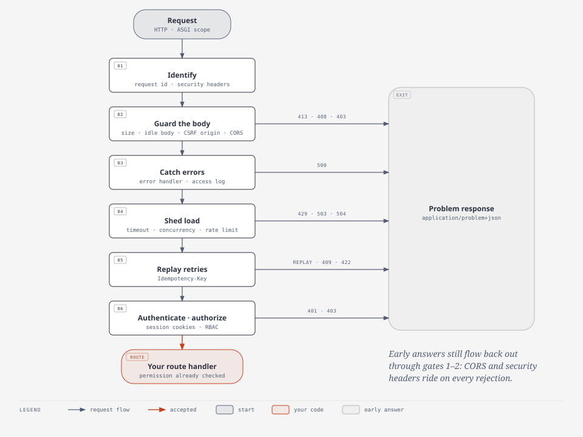
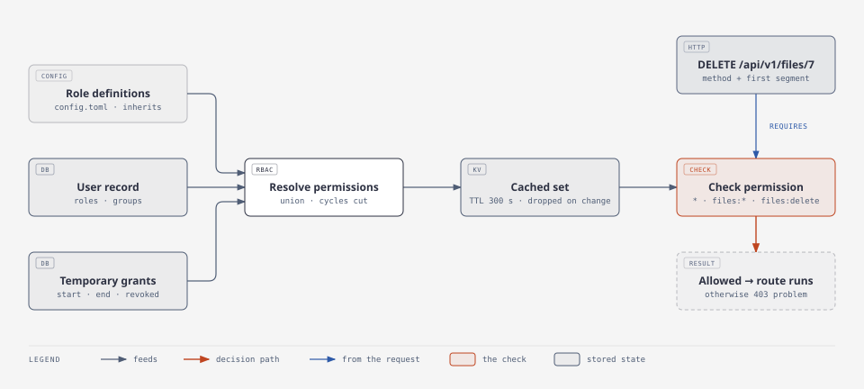
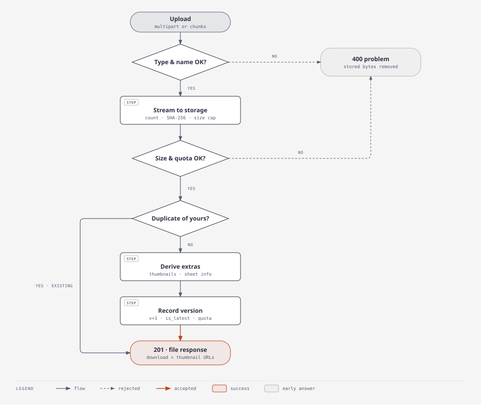

# Architecture

One deployable unit (a modular monolith): FastAPI app → services → data layer →
MongoDB / Redis / file storage. This page explains how the pieces fit and why; the
[security model](explanation/security-model.md) covers the defences, and the
[ADRs](adr/) record the decisions and the alternatives they rejected.

<picture>
  <source media="(prefers-color-scheme: dark)" srcset="diagrams/system-context-dark.svg">
  
</picture>

## Wiring

No DI framework and no globals ([ADR 0004](adr/0004-plain-wiring-and-pluggable-backends.md)).
`build_services(config)` (`app/services/registry.py`) constructs every service with ordinary
constructors, in dependency order, and returns a `Services` dataclass. `create_app()`
(`app/api/app.py`, run with `uvicorn --factory`) stores it on `app.state.services`; routes get
services through the dependencies in `app/api/deps.py`. Tests call `create_app(config)` and get
an isolated application, so several can live in one process.

`main.py` validates configuration, ensures a JWT secret, and starts uvicorn. On start-up the
lifespan (`app/utils/utils.py`) connects the data layer, runs migrations, ensures indexes,
creates the bootstrap admin if configured, and starts the upload janitor.

## Layers

<picture>
  <source media="(prefers-color-scheme: dark)" srcset="diagrams/code-layers-dark.svg">
  
</picture>

| Layer | Responsibility | Must not |
| --- | --- | --- |
| `routes/*` | HTTP: parse, call a service, shape the response | Contain business logic |
| `services/*` | Business rules (auth, RBAC, files, OAuth) | Touch MongoDB or Redis directly |
| `DataService` + `services/data/*_ops.py` | Cache-aware `get/set/update/delete/insert/increment`; per-collection queries and cache keys | Hold domain rules |
| `DatabaseService` / `CacheService` / `create_storage` | Select the backend, namespace keys, log failures, degrade | Seed data, log payloads |
| `database/*`, `cache/*`, `services/file/storage/*` | One engine each, behind an interface | Know collections, users or caching |

### Bring your own backend

Cache, database and file storage are interfaces with built-in implementations (`redis` /
`memory`, `mongodb`, `local` / `s3`). Set `app_cache_provider`, `app_database_provider` or
`file_storage_backend` to `package.module:YourClass`; the class implements `CacheInterface`,
`DatabaseInterface` or `StorageInterface` and is constructed with `(config, logger)`. Rate
limiting is a cache operation (`hit`), so any cache backend supports it. No driver is imported
outside its backend, so changing storage technology changes no application code;
[write a backend](how-to/write-a-backend.md) is the full contract.

### Rules worth knowing

- `set()` is an **upsert**; `update()` never creates a record. Use `update()` for edits.
- Writes invalidate cache entries instead of caching the written fragment. Records cached under
  several keys (users: id, username, email) are invalidated through their ops class.
- Security decisions (sign-in, file ownership) read the database, not the cache.
- Indexes are declared in `services/data/schema.py`; one-off changes are versioned migrations
  in `services/data/migrations.py`. Details: [data model](reference/data-model.md).

## The request pipeline

<picture>
  <source media="(prefers-color-scheme: dark)" srcset="diagrams/request-pipeline-dark.svg">
  
</picture>

All middleware is pure ASGI (`app/api/middleware/base.py`): no extra task per request,
streaming bodies stay streams, and context variables reach the route. Starlette runs the
*last added* middleware first, so `AppFactory.__setup_middleware` registers them
innermost-first. The order a request meets them:

| # | Middleware | Can answer early with |
| --- | --- | --- |
| 1 | `RequestIDMiddleware`: accept a safe caller id or make one; tag logs | |
| 2 | `SecurityHeadersMiddleware`: CSP, HSTS, frame, referrer, permissions headers | |
| 3 | `BodySizeLimitMiddleware`: cap and stream-count the body; cut off stalled bodies | 413, 408 |
| 4 | `CSRFOriginMiddleware`: Origin check for cookie-authenticated writes | 403 |
| 5 | `CORSMiddleware` (Starlette): preflights and grants | preflight answers |
| 6 | `ErrorHandlerMiddleware`: anything that escapes becomes a problem response | 500 |
| 7 | `AccessLogMiddleware`: one log line and one metrics sample per request | |
| 8 | `TimeoutMiddleware`: time limit and concurrency cap (off in debug) | 504, 503 |
| 9 | `RateLimiter`: per client IP and tier; fails open without a cache | 429 |
| 10 | `IdempotencyMiddleware`: replay or refuse retried unsafe requests | replay, 400, 409, 422, 503 |
| 11 | `SessionMiddleware`: write refreshed token cookies on the way out | |
| 12 | `RBACMiddleware`: authenticate, then require `<resource>:<action>` | 401, 403 |

The ordering is deliberate. CORS and security headers wrap everything that can reject a
request, so a 401 or 429 reaches a browser as itself instead of as an opaque CORS failure. The
error handler wraps the rest, so nothing escapes as a bare 500. Rate limiting runs before
authentication, so guessing is throttled before it costs a database lookup.

## Access control

<picture>
  <source media="(prefers-color-scheme: dark)" srcset="diagrams/rbac-resolution-dark.svg">
  
</picture>

One source of truth per kind of data: **definitions** (roles, permissions, groups, inheritance)
are configuration (`[rbac_roles.*]`, `[rbac_groups.*]` in `config.toml`), held in memory and
validated at start-up; **assignments** (a user's roles and groups) live on the user record;
**temporary grants** live in the `temporary_permissions` collection.

`RBACService.resolve_user_permissions` unions the inherited permissions of the user's roles, of
their groups' roles, and of active grants to the user or their groups, then caches the result
per user (`rbac_permission_cache_ttl`, 300 s). Any change to an input drops the entry. `*`
grants everything, `files:*` every action on files. Inheritance cycles are cut and logged.

`RBACMiddleware` also attributes the request for the audit log: it puts the caller's IP, user
agent and (once authenticated) user id in a context variable that `AuditService.record` reads,
so services record security changes without passing request details around.

`RBACMiddleware` authenticates every non-public path, then requires `*` on `admin_only_paths`
and `<resource>:<action>` everywhere else (resource = first segment after `/api/v1/`, action
from the method). Routes can add finer checks with `require_permission(...)` dependencies, as
`/rbac` does. A test fails if any route demands a permission no normal role can be given.

## Authentication model

Access tokens (15 min) and refresh tokens (7 or 30 days) are JWTs carrying a session id; a token
works only while its session lives, so revocation is immediate
([ADR 0001](adr/0001-session-bound-tokens.md)). Refresh tokens rotate, and replaying a rotated
one revokes the session. Sign-in failures lock an account after five attempts. The full model,
with its sequence diagram, is in the [security model](explanation/security-model.md#sessions-and-tokens).

## Files

<picture>
  <source media="(prefers-color-scheme: dark)" srcset="diagrams/file-upload-dark.svg">
  
</picture>

A file has a `file_id` and numbered versions, one record each, with immutable bytes. Uploads
and spreadsheet edits add versions. Everything is scoped to the owner; other users get 404.

- **Streaming end to end** ([ADR 0005](adr/0005-scale-out-files-and-cache-resilience.md)):
  upload → count, size-cap and SHA-256 → storage; storage → response. Memory does not grow
  with file size.
- **Chunked uploads** stage chunks on the storage backend under `_uploads/<user>/<upload_id>/`,
  with the session record in the cache keyed by user, so ids cannot be shared or hijacked. A
  background task purges abandoned staging every `file_cleanup_interval`.
- **Backends:** `local` (one host) or `s3` (shared, multipart uploads, optional direct
  downloads through presigned URLs with `file_download_redirect`).
- **Spreadsheets** ([ADR 0003](adr/0003-pure-python-spreadsheets.md)): one pure-Python
  processor. xlsx edits patch the zip package (`xlsx_package`, `xlsx_patch`), so charts,
  images, formulas and styles of everything not overwritten survive; ods and csv edits rebuild
  from values.

## Resilience

The cache is an accelerator, not a source of truth. When it fails, reads become misses (the
database answers), writes are skipped, and the backend is left alone for
`cache_failure_cooldown_seconds` instead of making every request wait out a timeout. Operations
that are meaningless without it say so: the rate limiter fails open, idempotent requests and
chunk sessions answer 503. See the state diagram in the
[runbook](how-to/operate.md#redis-is-down). Overload is shed, not queued forever: requests wait
at most `queue_wait_seconds` for one of `max_concurrent_requests` slots.

## Observability (optional, off by default)

`MetricsService` (Prometheus, private registry, route-template labels so scanners cannot create
series), `TracingService` (OpenTelemetry SDK with the official FastAPI, httpx, Redis and PyMongo
instrumentation, OTLP export) and `SentryService` (SDK integrations, request bodies never sent).
Logging is the standard library: readable console lines plus JSON lines in `logs/app.log`,
written by a background thread through a queue, each carrying the request id.

## Background jobs

`JobService` keeps jobs in the `jobs` collection and runs them in a worker loop started by the
lifespan (or by `python -m app.jobs`). Claiming is a conditional update that exactly one worker
wins; failures retry with backoff and jitter, then become `dead` and visible at
`/api/v1/admin/jobs`; a crashed worker's lease expires and the job runs again, so handlers are
idempotent. Handlers are registered in `register_job_handlers`
([ADR 0007](adr/0007-background-jobs-on-the-database.md),
[how-to](how-to/run-background-jobs.md)).

## Known limits

- xlsx: overwriting the anchor of a shared or array formula is refused; Excel recalculates
  formulas on next open. The previous version is always kept.
- The default `local` storage is one host's disk; use `s3` for more than one host. Uploads to S3
  pass through the API once; set `file_download_redirect` so downloads do not.
- The job queue polls the database: fine for hundreds of jobs a second, not for a firehose.
  Taskiq is the upgrade path ([ADR 0007](adr/0007-background-jobs-on-the-database.md)).
- `MemoryCache` is per process, so `app_workers > 1` with it is refused at start-up.
- Streamed (multipart, chunked or > 1 MiB) idempotent requests are compared by length, not content.
- Two simultaneous uploads of a new version of the same file on S3 can both pass the existence
  check; the unique index rejects the loser's record, whose cleanup may delete the winner's
  bytes. Rare; serialise versions per file if it matters.
- The storage quota sums up to the database result cap (10,000 versions); keep a counter on the
  user record if one user can legitimately hold more.
- A slow-but-steady request body is bounded only by the request timeout; keep a reverse proxy
  with its own timeouts in front of internet traffic.
- `app/services/file/__init__.py` → `file_service` → `spreadsheet_processor` →
  `app.services.file` is an import cycle (reported by the code graph). It works because the
  cycle only reaches sibling modules; break it before adding package-level imports there.
