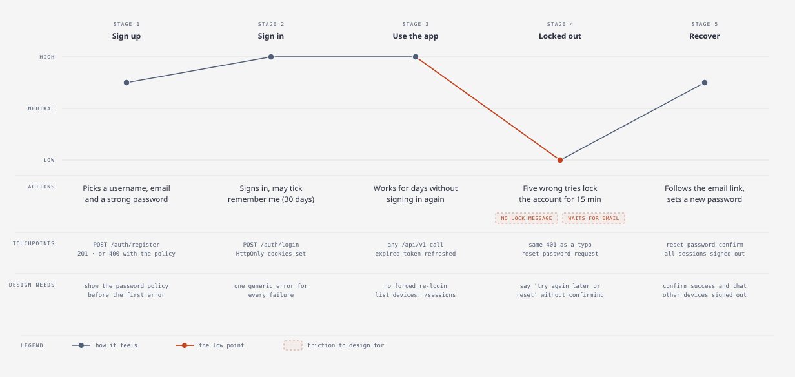
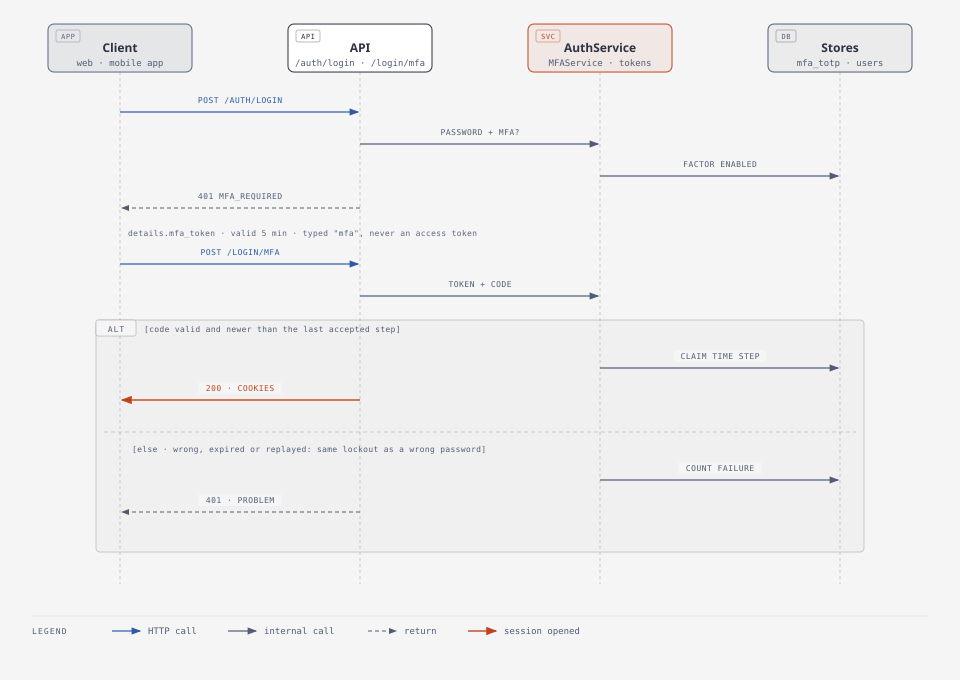

# For designers

The service has no screens of its own ([ADR 0002](../adr/0002-api-only.md)): every screen is
designed in the product that consumes it. This page translates the API into what a designer
needs: the flows, the states each screen must cover, and the copy rules that security imposes.

## The account journey

<picture>
  <source media="(prefers-color-scheme: dark)" srcset="../diagrams/account-journey-dark.svg">
  
</picture>

The low point is deliberate on the server's side: after five wrong passwords the account locks for
15 minutes, but the API answers exactly as it does for a typo, so that attackers learn nothing.
The product has to make that moment bearable without contradicting it.

## Screens and the states they need

| Screen | Endpoint | States to design |
| --- | --- | --- |
| Sign up | `POST /auth/register` | Password rules shown **before** the first attempt (8+ characters, upper, lower, digit, symbol by default); duplicate username or email (400 with a message); success. |
| Sign in | `POST /auth/login` | One generic error ("Username or password is incorrect"); "remember me" (30 days instead of 7); too many attempts (429 with `Retry-After`). |
| Two-factor sign-in | `POST /auth/login` → 401 `mfa_required`, then `POST /auth/login/mfa` | A code screen after the password, not an error; six-digit input (`inputmode="numeric"`, `autocomplete="one-time-code"`); a "use a recovery code" link; "code not valid" (401); the step expires after 5 minutes, so offer "start again". |
| Passkeys | `/auth/passkeys/...` | Offer "Sign in with a passkey" next to the password field (no username needed); after a password sign-in, suggest adding one; list passkeys by name and last use; name new ones ("MacBook", "Phone"); removal asks for confirmation. Use the platform's own prompt; never imitate it. |
| Two-factor setup | `/auth/mfa/totp`, `/confirm` | Ask for the password; show a QR code from `otpauth_uri` plus the `secret` for manual entry; confirm with a first code; then show the recovery codes **once**, with copy and download, and ask the user to save them before leaving. |
| Forgot password | `POST /auth/reset-password-request` | Always the same confirmation, whether or not the email exists. |
| Reset password | `POST /auth/reset-password-confirm` | Expired or used link (400); password rules; success, which also signs out every device. |
| Signed-in shell | any | Session refresh is silent; only a real 401 should send the user to sign in. |
| Profile | `GET`/`PATCH /auth/me` | First and last name. |
| Change password | `POST /auth/change-password` | Wrong current password (403); success says how many other devices were signed out. |
| API tokens | `/tokens` | Name, scopes as readable checkboxes, expiry picker; show the secret **once** with a copy button and a "you won't see this again" warning; list with prefix, last used and expiry; revoke with confirmation. |
| Devices | `/sessions/active` | Device, browser, last used, "this device"; sign out one or all. |
| Files | `/files/...` | Empty state; upload progress; type not allowed; too large; quota full; versions history; tags; soft-deleted. |
| Spreadsheet | `/files/{id}/spreadsheet/...` | Sheet tabs; save creates a new version (offer "view previous"); the last sheet cannot be deleted. |
| Admin: users | `/users` | Paged list with status filter; suspend/reactivate (suspending signs the person out everywhere); admins cannot disable themselves. |

Two-factor sign-in is a second screen after the password, not an error state:

<picture>
  <source media="(prefers-color-scheme: dark)" srcset="../diagrams/mfa-sign-in-dark.svg">
  
</picture>

## Turning errors into states

Errors arrive as [problem documents](../reference/api.md#errors) with `status`, `detail` and a
`code`. Map by status; show `detail` only where noted (it is written for people, but may be
technical).

| Status | Show | Notes |
| --- | --- | --- |
| 400 | `detail`, next to the field it concerns | Password policy, duplicate email, unsupported file type, quota. |
| 401 | Send to sign-in, keep the user's place | After a silent refresh failed. |
| 403 | "You don't have access to this" | Better: hide the control. The login response lists the user's `permissions`. |
| 404 | "Not found" | Also what another user's file looks like; never imply it exists. |
| 409 | "Still working on it, try again in a moment" | Same request already in progress, or an incomplete chunked upload. |
| 413 | "This file is larger than 100 MB" | Use the configured limit. |
| 422 | Field errors from `errors[].loc` | Malformed input; prevent with client-side validation. |
| 429 | "Too many attempts. Try again in N seconds" | Count down from `Retry-After`. |
| 503 | "Temporarily unavailable, retrying…" | Retry automatically with backoff. |
| 500 | Generic apology + the `X-Request-ID` value | So support can find the request. |

## Patterns the API expects

- **Retry buttons are safe** when the client sends an `Idempotency-Key` header (a random id per
  user action, reused on retry). A second click replays the first result instead of creating a
  duplicate. Design retry affordances freely for uploads and edits.
- **Large uploads** use chunks: `POST /files/upload/chunk` answers `chunks_received` of
  `total_chunks`, which is the progress bar. Chunks may arrive in any order and be retried.
- **Lists are paged** (`page`, `page_size` up to 200, `total`, `has_next`): design pagination or
  "load more", not infinite unbounded lists.
- **Downloads** always arrive as attachments (never rendered in the browser), so a preview must
  be built from thumbnails (150, 300, 600 px for images) or spreadsheet data.
- **Every edit is a version.** Uploading to an existing file or editing a spreadsheet keeps the
  previous version; a history view costs nothing on the server.

## Copy rules from security

- Never confirm whether an account or email exists on sign-in or password reset. (Sign-up does
  say when a username or email is taken: the usual trade-off for a usable registration form.)
- Never say "your account is locked": say "Try again later, or reset your password".
- After a password reset or change, tell the user other devices were signed out.
- Explain password rules up front; the server message is the fallback, not the design.
