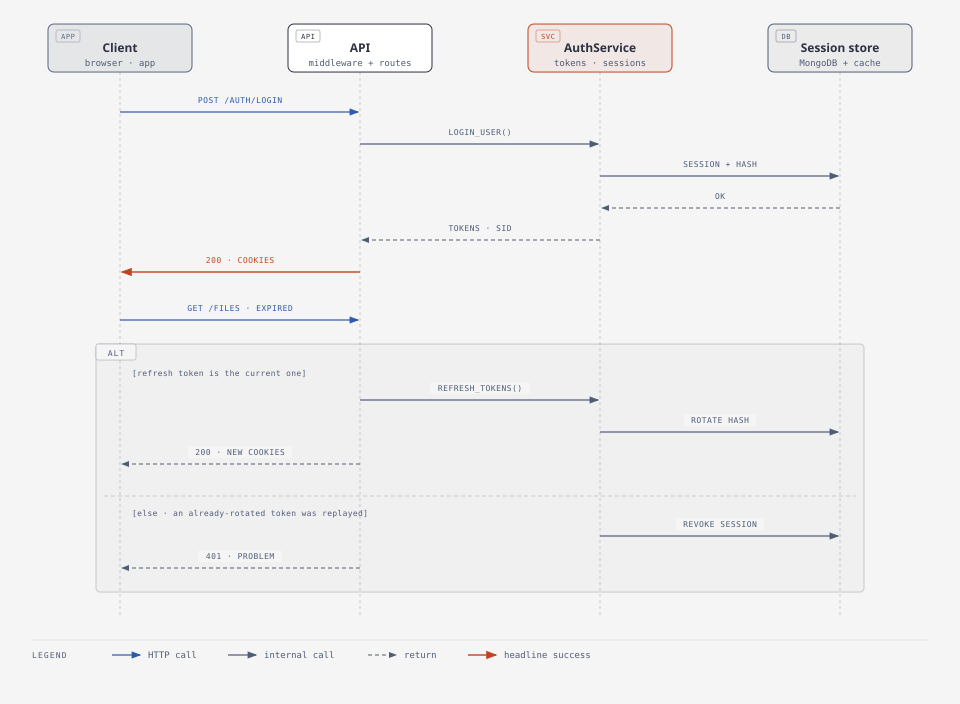

# Security model

What the service defends against, and where each defence lives. Most rows in the first table
are pinned by a regression test, chiefly in `tests/test_security_fixes.py` and
`tests/test_auth_flow.py`.

## Threats and controls

| Threat | Control | Where |
| --- | --- | --- |
| Stolen token used after logout or reset | Tokens carry a session id; the session must be live | `utils/permissions.py`, [ADR 0001](../adr/0001-session-bound-tokens.md) |
| Stolen refresh token | Single-use rotation; replaying a rotated token revokes the session | `AuthService.refresh_tokens` |
| Password guessing | Lockout after 5 failures for 15 min, counted atomically; auth rate tier | `AuthService.authenticate`, `RateLimiter` |
| Username discovery | Same answer and same time for unknown user, wrong password, locked or disabled account; reset request never reveals whether the email exists | `_equalize_timing`, `request_password_reset` |
| Cross-site request forgery | `SameSite=Lax` cookies plus an Origin/Referer check on cookie-authenticated writes | `middleware/csrf.py` |
| Token theft by script | Auth cookies are HttpOnly and Secure (outside debug) | `utils/cookie_manager.py` |
| Privilege escalation | Deny by default; public registration cannot choose roles; managers cannot suspend admins | `middleware/rbac.py`, `routes/users.py` |
| Reading others' data | Ownership checked on every file and session; others' resources answer 404 | `FileService.get_owned`, `routes/sessions.py` |
| Account pre-hijacking via Google | Only verified provider emails; an unverified local account with that email loses its password and sessions first | `OAuthBase.create_or_link_user` |
| OAuth login CSRF | State bound to an HttpOnly cookie and compared in constant time | `routes/oauth.py` |
| Malicious uploads | Type allow-list, HTML/SVG refused, downloads always `attachment`, `no-store`, sanitised names | `FileService`, `routes/files/common.py` |
| Path traversal | Storage paths resolved and confined to the base (symlinks included); upload ids restricted | `storage/local.py`, `storage/s3.py`, `chunked_upload.py` |
| Resource exhaustion | Body size cap and idle-body cut-off, timeouts, concurrency cap, per-user quota, version cap, cell cap, image pixel cap, zip-bomb and DTD refusal | `middleware/body_limit.py`, `timeout.py`, `image_processor.py`, `xlsx_package.py` |
| Spreadsheet formula injection | Text starting with `=`/`@` (or `+`/`-` when not a number) is stored with a leading apostrophe | `spreadsheet_processor.neutralize` |
| Secret leakage | No secrets in the repo; generated key written 0600; placeholder secrets refused; request bodies never sent to Sentry; secrets masked in `make config` | `config.py`, `settings.py`, `services/sentry.py` |
| Log forging | Line breaks in request-controlled text are escaped; caller request ids must match a safe pattern | `services/logger.py`, `middleware/security.py` |
| Untraceable administrative changes | Role, group, grant, account-status, deletion, password and session changes are written to `audit_events` with actor, IP, user agent and request id | `services/audit.py`, `GET /admin/audit-events` |
| Stale or forged client IPs | `X-Forwarded-For` trusted only for `trusted_proxy_count` hops | `utils/utils.client_ip` |

## Sessions and tokens

<picture>
  <source media="(prefers-color-scheme: dark)" srcset="../diagrams/auth-sequence-dark.svg">
  
</picture>

- **Access token**: JWT, 15 minutes, carries user id, roles, resolved permissions and the
  session id (`sid`). Signed with HS256/384/512 only; the key must be at least 32 characters.
- **Refresh token**: JWT, 7 days (30 with "remember me"). Only its SHA-256 hash is stored, on
  the session.
- **Every request** verifies the signature, expiry and type, then that the session exists, is
  not revoked and has not expired. That is one cached lookup, and it is why logout, "sign out
  everywhere", password change, password reset and suspension take effect immediately.
- **Rotation**: each refresh issues a new pair and replaces the stored hash. Presenting the
  previous token within 30 seconds is tolerated (two tabs refreshing at once); after that it is
  treated as stolen and the whole session is revoked.
- **Permissions in the token are informational.** Authorization always resolves the user's
  current permissions (cached up to 5 minutes, dropped on any change), so removing a role
  takes effect on the next request.

## Sign-in protection

The failure counter is incremented **before** the password is checked, atomically in the
database. Of a burst of parallel guesses, at most `auth_max_failed_logins` ever reach the
(expensive) Argon2 verification; the account then locks. Unknown users still spend one Argon2
verification against a dummy hash, so response time does not reveal which usernames exist. Every
attempt is recorded in `login_attempts` for 90 days.

Passwords: Argon2id, hashed in a worker thread (never on the event loop), at most 128
characters, policy configurable (default: 8+ characters with upper, lower, digit and symbol).

## Browser defences

- **CORS**: exact origins only (`*` with credentials is refused at start-up); `localhost`
  only in debug. CORS and security headers wrap every rejection, so a 401 or 429 reaches the
  browser as itself rather than as an opaque CORS failure.
- **CSRF**: unsafe methods with cookies and without `Authorization` must come from an allowed
  origin or the API's own host. Requests with no Origin/Referer (non-browser clients) pass.
- **Headers**: strict CSP (`default-src 'self'`, `frame-ancestors 'none'`), HSTS over HTTPS,
  `X-Frame-Options: DENY`, `nosniff`, `Referrer-Policy`, a restrictive `Permissions-Policy`,
  and no `Server` header.

## Google sign-in

Off unless `oauth_enabled`. The provider must vouch for the email (`email_verified`). If a local
account already uses that address but never proved it, whoever registered it might not own
it, so its password is cleared and its sessions revoked before the provider is linked. Provider
access tokens are not stored. Linking a provider to an already signed-in account is not
implemented (501).

## Not covered

- Multi-factor authentication and CAPTCHA.
- Audit events record *that* something changed and who changed it, not the before and after
  values; they are as tamper-proof as the database that stores them.
- Slow-but-steady request bodies are bounded only by the request timeout: keep a reverse proxy
  with its own timeouts in front of internet traffic.
- Registration says when a username or email is already taken (sign-in and reset never do).
- Malware scanning of uploads.
- Encryption at rest is the storage's job (MongoDB, disk, S3 settings).

See also: [request pipeline](../ARCHITECTURE.md#the-request-pipeline),
[access control](../ARCHITECTURE.md#access-control), [runbook: compromise](../how-to/operate.md#an-account-or-token-may-be-compromised).
