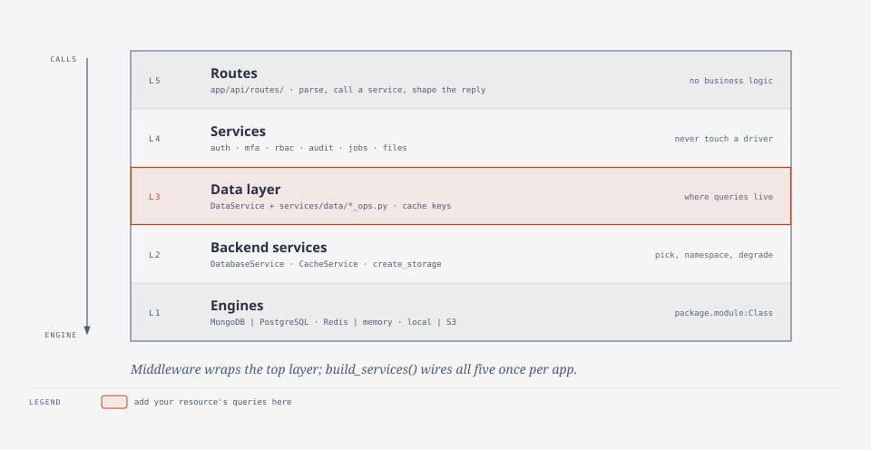

# Add a resource

A new resource ("part", "order", ...) touches five small places. This guide adds a `parts`
resource; `files` is the fullest existing example to copy from. Read
[Architecture → Layers](../ARCHITECTURE.md#layers) first if the layer names are new to you.

<picture>
  <source media="(prefers-color-scheme: dark)" srcset="../diagrams/code-layers-dark.svg">
  
</picture>

## 1. Model: `app/models/part.py`

Pydantic models for request and response bodies. Validation lives here, at the boundary.

```python
from pydantic import BaseModel, Field


class PartCreate(BaseModel):
    name: str = Field(..., min_length=1, max_length=200)
    quantity: int = Field(0, ge=0)


class Part(PartCreate):
    id: str
    owner_id: str
```

## 2. Data: `app/services/data/parts_ops.py`

One class per collection holds the collection name and its queries. Use `DataService.update`
for edits (`set` is an upsert and would create a record from a stale id), and
`CachePolicy.DB_ONLY` for anything a security decision reads.

```python
import uuid
from datetime import UTC, datetime

from .policies import CachePolicy


class PartsOps:
    collection = "parts"

    def __init__(self, service) -> None:
        self.service = service

    async def create(self, owner_id: str, data: dict) -> str:
        part_id, now = uuid.uuid4().hex, datetime.now(UTC)
        await self.service.insert(
            self.collection,
            {**data, "id": part_id, "owner_id": owner_id, "created_at": now, "updated_at": now},
        )
        return part_id

    async def get(self, part_id: str) -> dict | None:
        return await self.service.get(self.collection, {"id": part_id}, policy=CachePolicy.DB_ONLY)

    async def list(self, owner_id: str, *, limit: int, skip: int) -> tuple[list[dict], int]:
        filters = {"owner_id": owner_id}
        page = await self.service.find_many(
            self.collection, filters, limit=limit, skip=skip, sort=[("created_at", -1)]
        )
        return page, await self.service.count(self.collection, filters)
```

Register it in `DataService.__init__` (`self.parts = PartsOps(self)`) and declare its
indexes in `app/services/data/schema.py`, next to the others:

```python
"parts": [
    {"keys": [("id", ASCENDING)], "unique": True},
    {"keys": [("owner_id", ASCENDING), ("created_at", DESCENDING)]},
],
```

Indexes are applied on every start-up; one-off data changes go into a
[migration](#other-common-changes).

## 3. Rules: `app/services/part_service.py` (only if needed)

Pure CRUD can call `data_service.parts` straight from the route. As soon as there is a rule
("quantity cannot drop below what is reserved"), put it in a service, build it in
`services/registry.py::build_services`, and add the field to `Services`.

## 4. Routes: `app/api/routes/parts.py`

A route parses, calls, and shapes the reply. Client mistakes are `HTTPException`s; the
handlers turn them into `application/problem+json`.

```python
from fastapi import APIRouter, Depends, HTTPException, Query, status

from app.api.deps import get_data_service
from app.models.auth import TokenPayload
from app.models.part import Part, PartCreate
from app.services.data import DataService
from app.utils.permissions import get_current_user

router = APIRouter(prefix="/parts", tags=["Parts"])


@router.post("", response_model=Part, status_code=status.HTTP_201_CREATED)
async def create_part(
    body: PartCreate,
    user: TokenPayload = Depends(get_current_user),
    data: DataService = Depends(get_data_service),
) -> Part:
    part_id = await data.parts.create(user.user_id, body.model_dump())
    return Part(id=part_id, owner_id=user.user_id, **body.model_dump())


@router.get("/{part_id}", response_model=Part)
async def get_part(
    part_id: str,
    user: TokenPayload = Depends(get_current_user),
    data: DataService = Depends(get_data_service),
) -> Part:
    record = await data.parts.get(part_id)
    if not record or record["owner_id"] != user.user_id:  # someone else's part looks missing
        raise HTTPException(status_code=status.HTTP_404_NOT_FOUND, detail="Part not found")
    return Part(**record)
```

Include the router in `AppFactory.__setup_routes` (`app/api/app.py`):
`self.app.include_router(parts_router, prefix="/api/v1")`.

Collection endpoints are paged: copy `list_files` (`page`, `page_size` ≤ 200, `total`,
`has_next`). If the collection can grow without bound, also offer `cursor`/`next_cursor` with
`app/services/data/cursor.py`, as `list_files` does.

Then regenerate the API contract and review its diff: `make openapi`.

## 5. Permissions: `config.toml`

The RBAC middleware requires `parts:read` for `GET`, `parts:write` for
`POST/PUT/PATCH`, and `parts:delete` for `DELETE` (resource = first path segment after
`/api/v1/`). Grant them to a role:

```toml
[rbac_roles.user]
permissions = [..., "parts:read", "parts:write", "parts:delete"]
```

You cannot forget this step: `test_every_authenticated_api_route_is_grantable_to_a_normal_user`
fails until some role holds every permission your routes demand.

## 6. Test it through the real app

Copy `tests/test_features.py`: `env.client()` builds the full application with in-memory
MongoDB and Redis stand-ins, so you can register, sign in and call your endpoints. Cover the
decision branches (the 404 for someone else's part), not just the happy path.

```bash
make test && make lint && make fuzz
```

`make fuzz` sends generated requests to your new routes and fails on any 500 or undocumented
answer.

## Other common changes

- **A new setting:** add a field to `Settings` in `app/settings.py` (type, default,
  description), read it as `config["name"]`, run `make config-docs`. A test fails if
  [`CONFIGURATION.md`](../CONFIGURATION.md) is stale.
- **A data migration:** append `Migration(n, "what", fn)` to `services/data/migrations.py`. It
  runs once at start-up, is recorded in `schema_migrations`, and must be idempotent (several
  workers may start at once). Never edit a released migration.
- **A different cache, database or storage:** implement `CacheInterface`, `DatabaseInterface`
  or `StorageInterface` and set `app_cache_provider`, `app_database_provider` or
  `file_storage_backend` to `package.module:ClassName`. A storage backend only needs the
  abstract methods; override `save_stream`/`open_stream` to avoid buffering whole files.
- **A public endpoint:** add its path to `public_paths`. **Admin-only:** `admin_only_paths`.
- **A retried POST made safe:** nothing to do. Clients send `Idempotency-Key`
  ([API → Idempotency](../reference/api.md#idempotency)).
- **A stricter rate limit for some paths:** a `rate_limit_tiers` entry in `config.toml`.
- **A security-relevant change** (who can do what, account state): record it from the service
  with `await self.audit.record("part.transferred", target_type="part", target_id=...)`; it then
  reaches the audit log and any webhook subscribed to it.
- **Tell other systems:** `await webhook_service.publish("part.created", {...})`
  ([webhooks](use-webhooks.md)). **Slow work:** a job ([background jobs](run-background-jobs.md)).
