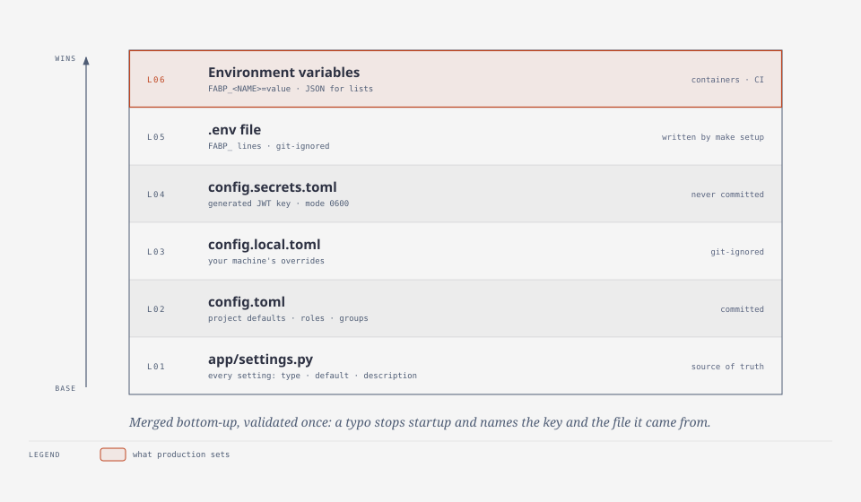

# Configure common features

Every setting is declared once in `app/settings.py`; the full list with types and defaults is
the [configuration reference](../CONFIGURATION.md). This page covers the changes people
actually make.

<picture>
  <source media="(prefers-color-scheme: dark)" srcset="../diagrams/config-layers-dark.svg">
  
</picture>

## Where to put a value

| Kind of value | Put it in | Committed? |
| --- | --- | --- |
| Project-wide default, roles and groups | `config.toml` | yes |
| Your machine's overrides | `config.local.toml` | no |
| Generated JWT and MFA keys | `config.secrets.toml` (written on first start, mode 0600) | no |
| Container or CI value, any secret | `FABP_<NAME>` environment variable (or `.env` locally) | no |

Sources merge **per setting**, not per nested key: a `[rbac_roles.*]` or `[rate_limit_tiers.*]`
table in `config.local.toml` replaces the whole `rbac_roles` / `rate_limit_tiers` value from
`config.toml`. Change roles and tiers in `config.toml`.

Any setting works as an environment variable: upper-case its name and prefix `FABP_`. Lists and
objects are JSON: `FABP_CORS_ORIGINS='["https://app.example.com"]'`.

```bash
make config                   # every effective value and the source that set it
python -m app.settings check  # validate only; exits non-zero on mistakes
```

A mistake stops start-up with a precise message, for example
`unknown setting 'mongo_hots' (from config.local.toml). Did you mean 'mongo_host'?`

The committed defaults are production-safe: debug off, loopback bind, Secure cookies, strict
CSP. Development conveniences are opted into by `config.local.toml`.

## Let a browser front end call the API

```toml
cors_origins = ["https://app.example.com"]   # exact origins; "*" is refused
```

Cookie-authenticated writes must come from one of these origins (`csrf_origin_check`). In debug
mode any `localhost` port is also allowed. Bearer-token clients are not affected.

## Run behind a reverse proxy

```toml
app_host = "0.0.0.0"          # only inside a container or behind the proxy
trusted_proxy_count = 1       # proxies in front of the app
```

Without `trusted_proxy_count` every client shares the proxy's address, so one client can use up
the login rate limit for everyone, and the audit log records the proxy. Keep the proxy's own
connection and body timeouts: the app cuts off stalled bodies but not slow, steady ones.

## Use more than one worker or server

```toml
app_workers = 4
app_cache_provider = "redis"   # required: the memory cache is per process
file_storage_backend = "s3"    # required with more than one server (plus s3_bucket, below)
```

`app_workers > 1` with the memory cache is refused at start-up: each worker would keep its own
rate-limit counters and sessions, silently multiplying every limit.

## Use PostgreSQL instead of MongoDB

```bash
make up-postgres                        # PostgreSQL 17 in Docker (loopback only)
pip install -r requirements-postgres.txt  # asyncpg (already in requirements-dev.txt)
```

```toml
# config.local.toml
app_database_provider = "postgres"
```

`make setup` already wrote `FABP_POSTGRES_PASSWORD` and `FABP_POSTGRES_PORT` into `.env`. In
production set `FABP_POSTGRES_HOST`, `FABP_POSTGRES_USERNAME`, `FABP_POSTGRES_PASSWORD` and
`FABP_POSTGRES_DATABASE`, and build the image with `--build-arg INSTALL_POSTGRES=true`.
PostgreSQL 15 or newer. Each collection becomes a JSONB table in the schema named by
`app_database` ([ADR 0006](../adr/0006-postgresql-as-jsonb-documents.md)); nothing in the
application changes.

## Store files in S3 (or MinIO, R2, ...)

```bash
pip install -r requirements-s3.txt          # or: docker build --build-arg INSTALL_S3=true
```

```toml
file_storage_backend = "s3"
s3_bucket = "my-bucket"
s3_key_prefix = "uploads"
s3_region = "eu-west-1"
# s3_endpoint_url = "https://minio.internal:9000"   # S3-compatible services
file_download_redirect = true   # downloads go straight to the bucket via short-lived URLs
```

Credentials come from `s3_access_key_id`/`s3_secret_access_key` or boto3's usual chain (IAM role,
environment). Add a bucket lifecycle rule that expires the `_uploads/` prefix and incomplete
multipart uploads.

## Send password-reset email

```toml
smtp_host = "smtp.example.com"
smtp_port = 587
smtp_username = "no-reply@example.com"
smtp_from = "no-reply@example.com"
password_reset_url_template = "https://app.example.com/reset?token={token}"
```

Set `FABP_SMTP_PASSWORD` in the environment. Without `smtp_host` the message is not sent and an
error is logged (in debug mode the whole message is logged, so local testing works).

Locally, `make up-mail` starts [Mailpit](https://mailpit.axllent.org), which accepts every
message and shows it at <http://127.0.0.1:8025>; uncomment the `smtp_*` lines in
`config.local.toml` to send to it.

## Sign in with Google

```toml
oauth_enabled = true

[oauth_providers.google]
client_id = "..."
client_secret = "..."   # better: in config.secrets.toml or the environment
redirect_uri = "https://api.example.com/api/v1/oauth/google/callback"
scopes = ["openid", "email", "profile"]
authorization_url = "https://accounts.google.com/o/oauth2/v2/auth"
token_url = "https://oauth2.googleapis.com/token"
userinfo_url = "https://www.googleapis.com/oauth2/v3/userinfo"
```

Only Google accounts with a verified email can sign in. Signing in with an address that matches
an unverified local account takes that account over safely: its password and sessions are
cleared first ([security model](../explanation/security-model.md#google-sign-in)).

## Change roles, groups and limits

```toml
default_role = "user"      # what self-registration gets (plain keys before any [table])

[rbac_roles.editor]
permissions = ["files:*", "reports:read"]
inherits = ["user"]

[rbac_groups.editors]
roles = ["editor"]

[rate_limit_tiers.auth]
requests = 10
window = 300
patterns = ["/auth/login", "/auth/register", "/auth/reset"]

[endpoint_timeouts]
"/api/v1/files/upload" = 600
```

Put these in `config.toml`. Permissions are `<resource>:<action>`; `*` grants everything and
`files:*` every action on files. References to unknown roles fail start-up.

## Turn on observability

```toml
metrics_enabled = true                   # Prometheus text at /api/v1/metrics (admins only)
tracing_enabled = true
otlp_endpoint = "http://otel-collector:4317"
sentry_enabled = true                    # plus FABP_SENTRY_DSN in the environment
```

All three are off by default. Tracing and Sentry need their packages:
`pip install -r requirements-observability.txt`, or build the image with
`--build-arg INSTALL_OBSERVABILITY=true`; turning one on without it stops start-up with that
instruction. Logs are always on: readable lines on stderr and JSON lines in
`logs/app.log` (`log_to_file`), each tagged with the request id.
