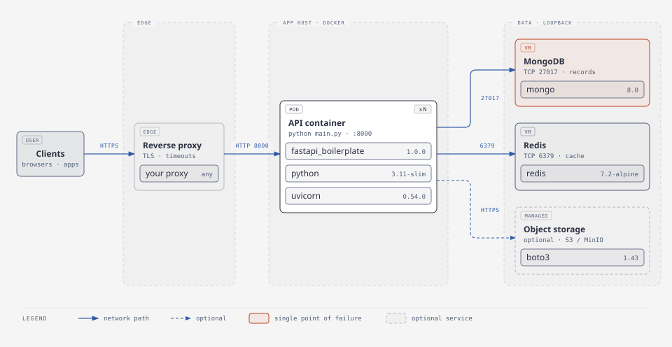

# Deploy

The service ships as one container image. It needs MongoDB, ideally Redis, and, beyond a
single server, S3-compatible storage. Put a reverse proxy in front for TLS.

<picture>
  <source media="(prefers-color-scheme: dark)" srcset="../diagrams/deployment-dark.svg">
  
</picture>

## Build the image

```bash
make docker-build                                   # fastapi_boilerplate:local
docker build --build-arg INSTALL_S3=true -t fastapi_boilerplate:s3 .   # with boto3 for S3
```

The image is `python:3.11-slim`, runs as an unprivileged user, listens on `0.0.0.0:8000`, and
has a health check on `/api/v1/live`. Only `app/`, `config.toml`, `config.py` and `main.py`
are copied in; local config, secrets and `graphify-out/` stay out (`.dockerignore`).

## Try the whole stack locally

```bash
make setup         # once: .env with random passwords and free ports
make docker-up     # API + MongoDB + Redis via docker compose --profile app
```

Every published port binds to `127.0.0.1`, so nothing is reachable from your network.

## Production checklist

Configuration is environment variables (`FABP_<NAME>`); see [configure](configure.md).

| Item | Setting | Why |
| --- | --- | --- |
| Signing key | `FABP_JWT_SECRET` (≥ 32 random characters) | Otherwise each new container generates its own key and every token stops working. The placeholder from `.env.example` is refused. |
| Two-factor key | `FABP_MFA_ENCRYPTION_KEY` (≥ 32 random characters) | Encrypts authenticator secrets. Keep it stable: a new key makes every existing two-factor setup unusable. |
| PostgreSQL (optional) | `FABP_APP_DATABASE_PROVIDER=postgres`, `FABP_POSTGRES_*`, image built with `INSTALL_POSTGRES=true` | Instead of MongoDB; PostgreSQL 15+. |
| Database credentials | `FABP_MONGO_HOST`, `FABP_MONGO_USERNAME`, `FABP_MONGO_PASSWORD` | |
| Cache | `FABP_REDIS_HOST`, `FABP_REDIS_PASSWORD` | Shared rate limits, sessions cache and retry protection. |
| Proxy | `FABP_TRUSTED_PROXY_COUNT=1` | Real client IPs for rate limits and the audit log. |
| Browser origins | `FABP_CORS_ORIGINS='["https://app.example.com"]'` | Needed for cookie-based front ends. |
| Scale-out | `FABP_APP_WORKERS`, `FABP_FILE_STORAGE_BACKEND=s3` | More than one worker needs Redis; more than one server needs S3. |
| Debug | leave `app_debug` unset (false) | Debug enables `/docs`, relaxes cookies and CSP. |
| First admin | `FABP_BOOTSTRAP_ADMIN_*` once, then remove | Created only while the user collection is empty. |
| Email | `FABP_SMTP_*`, `FABP_PASSWORD_RESET_URL_TEMPLATE` | Password resets. |
| Background jobs | `FABP_JOBS_RUN_IN_API`, or a `python -m app.jobs` service | Workers inside the API by default; separate them when jobs are heavy. |
| Observability (optional) | image built with `INSTALL_OBSERVABILITY=true` | Needed for `tracing_enabled` and `sentry_enabled`; Prometheus metrics are always available. |
| Backups | MongoDB, and local `uploads/` if not on S3 | The only state worth keeping; Redis is a cache. |

## Probes

| Probe | Path | Meaning |
| --- | --- | --- |
| Liveness | `/api/v1/live` | The process answers. Restart only if this fails. |
| Readiness | `/api/v1/ready` | 503 until MongoDB and the cache answer; take out of rotation meanwhile. |
| Startup | `/api/v1/startup` | 503 until both backends have connected. |
| Load balancer | `/api/v1/health` | Up, with service name and version. Checks nothing else. |

All four are public and never rate-limited.

## Start-up sequence

On start the app validates configuration, ensures a JWT secret, connects MongoDB and the cache,
runs pending [migrations](../reference/data-model.md#migrations), ensures indexes, creates the
bootstrap admin if configured, and starts a background task that purges abandoned chunked
uploads every `file_cleanup_interval` seconds. Several workers starting at once is safe:
migrations and index creation are idempotent.

When something goes wrong after deployment, use the [operations runbook](operate.md).
