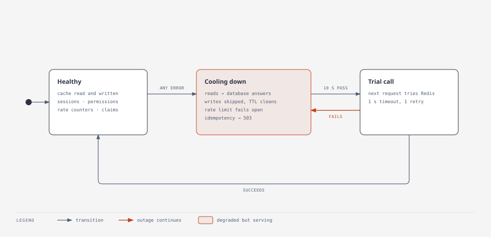

# Operations runbook

Symptoms, how to confirm them, and what to do. For first-time setup see [deploy](deploy.md).

## Where to look first

- **Probes:** `/api/v1/ready` reports MongoDB and cache status with latency, plus free disk.
- **Logs:** one line per request on stderr (`METHOD /path -> status`, duration, user id), and
  JSON lines in `logs/app.log`. Every response carries `X-Request-ID`; search the logs for it.
  Clients may send their own `X-Request-ID` (8–64 safe characters) to correlate across services.
- **Configuration:** `make config` (or `python -m app.settings show`) prints every effective
  value and its source, with secrets masked.
- **Metrics:** with `metrics_enabled`, admins can read `/api/v1/metrics`
  (`http_requests_total`, `http_request_duration_seconds`, labelled by route template).

## The app does not start

The process prints `Configuration is invalid:` followed by every problem, each naming the key
and the file or variable it came from. Fix those values; `python -m app.settings check`
re-validates without starting. Common ones:

| Message | Fix |
| --- | --- |
| `jwt_secret ... is still the placeholder` | Set a real `FABP_JWT_SECRET`, or run `make setup` locally. |
| `app_cache_provider = 'memory' ... cannot be used with app_workers` | Use Redis, or one worker. |
| `file_storage_backend = 's3' needs s3_bucket` | Set `s3_bucket`. |
| `inherits unknown role` / `references unknown role` | Fix `rbac_roles` / `rbac_groups` in `config.toml`. |

## MongoDB is down or refuses credentials

**Symptoms:** `/api/v1/ready` answers 503 with `database: not_ready`; requests fail with 500.

- `MongoDB rejected the credentials` in the log, **locally**: you regenerated `.env` while an
  old Docker volume still holds the previous password. `make reset-data` deletes the local
  databases; then `make up`.
- In production, check `FABP_MONGO_*` and that the server is reachable within
  `mongo_timeout_ms` (5 s).

MongoDB is the source of truth; the service cannot answer without it.

## Redis is down

**Symptoms:** `/api/v1/ready` shows `cache: not_ready`; the log says
`Cache get failed (...); not using the cache for 10s`. Most requests still succeed, a little slower.

<picture>
  <source media="(prefers-color-scheme: dark)" srcset="../diagrams/cache-outage-dark.svg">
  
</picture>

What users notice while the circuit is open:

| Feature | Behaviour |
| --- | --- |
| Reads (users, sessions, permissions) | Served from MongoDB. |
| Rate limiting | **Off** (fails open); account lockout still protects sign-in. |
| Requests with `Idempotency-Key` | 503 with `Retry-After: 5`, so a retry cannot run twice. |
| Chunked uploads | 503: their session lives only in the cache. |

Nothing to do in the app: it retries Redis after each cool-down (`cache_failure_cooldown_seconds`)
and recovers by itself. Fix Redis; cached entries that could not be deleted expire by TTL.

## Everyone gets 429 Too Many Requests

The service probably sees every client as the proxy's address. Set
`trusted_proxy_count` to the number of proxies in front of it. Limits per tier are in
`rate_limit_tiers`; the auth tier allows 10 requests per 5 minutes per client.

## 503 "Server overloaded" or 504 timeouts

More than `max_concurrent_requests` (100) were in flight and a slot did not free up within
`queue_wait_seconds` (5 s), or a request ran past `request_timeout_seconds` (30 s). Raise limits
deliberately, give slow paths their own `endpoint_timeouts`, or add workers or servers.

## A user is locked out

Five wrong passwords lock an account for 15 minutes (`auth_max_failed_logins`,
`auth_lockout_minutes`). The API gives the same answer as a wrong password, by design. Options:
wait; or have the user reset their password (a completed reset also clears the lock).

## An account or token may be compromised

| Scope | Action |
| --- | --- |
| One device | The user revokes it: `DELETE /api/v1/sessions/{id}`. |
| All of a user's devices | The user: `DELETE /api/v1/sessions/all`. A manager or admin: suspend with `PATCH /api/v1/users/{id}` `{"status":"suspended"}` (signs out everywhere), later `"active"`. |
| A stolen refresh token | Replaying an already-rotated refresh token revokes that session automatically. |
| Everyone | Rotate the signing key: set a new `FABP_JWT_SECRET` and restart every instance. All tokens stop validating; everyone signs in again. |

Login attempts (success and failure, with IP and user agent) are kept 90 days in the
`login_attempts` collection.

## Disk filling up

`/api/v1/ready` reports `disk.free_gb` for the local storage path. Per-user limits are
`file_user_quota_bytes` (5 GiB, soft-deleted files included) and `file_max_versions`. Soft
deletes keep bytes; `DELETE /api/v1/files/{id}?hard_delete=true` frees them. Abandoned chunked
uploads are purged automatically after `file_upload_ttl`.

## Roll back a release

Redeploy the previous image. Migrations run forward only. The two so far only add the
`is_latest` flag and drop obsolete indexes, which an earlier release of this codebase ignores.
Before shipping a migration that renames or removes data, decide how a rollback reads it. Never
edit or delete an applied migration; add a new one.
