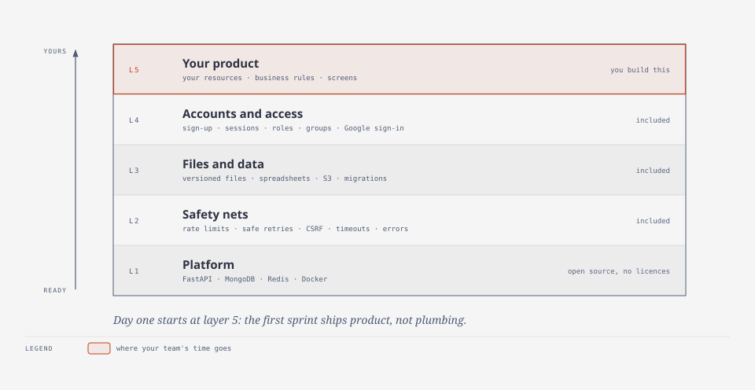
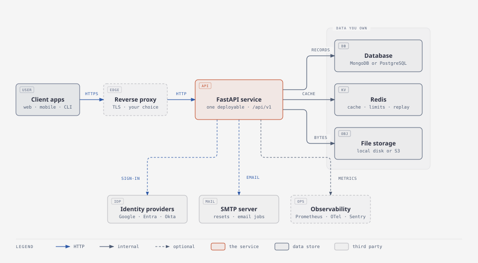

# For decision makers

**In one sentence:** a production-ready back end that already handles accounts, access rights,
files and the safety nets every public API needs, so your team's first sprint ships product
instead of plumbing.

<picture>
  <source media="(prefers-color-scheme: dark)" srcset="../diagrams/what-you-get-dark.svg">
  
</picture>

## How it helps the business

| Outcome | How |
| --- | --- |
| **Faster to market** | Sign-in, roles, file handling and admin endpoints exist on day one. A new feature touches [five small places](../how-to/add-a-resource.md). |
| **Lower risk** | Security-reviewed defaults: revocable sessions, lockout, CSRF and CORS checks, safe file handling, secrets kept out of the code. [Security model](../explanation/security-model.md). |
| **Lower running cost** | One container plus MongoDB and Redis; no licences. Starts on a single small server and scales out by adding containers. |
| **No lock-in** | Database, cache and file storage are swappable behind interfaces: start on MongoDB and Redis, move to PostgreSQL or a managed cloud service later without rewriting the application ([how](../how-to/write-a-backend.md)). |
| **Easy to staff** | Python, FastAPI, MongoDB, Redis, Docker: mainstream, well-documented tools. Clone to running in about ten minutes. |
| **Changes stay cheap** | 197 automated tests run in seconds on every change; architecture decisions are written down ([ADRs](../adr/)). |
| **Operable by others** | Health probes, structured logs with request ids, a [runbook](../how-to/operate.md), and optional metrics, tracing and error reporting. |

## What you can build with it

Any product whose back end is "users who sign in, own things, and are allowed to do some
things but not others":

- **SaaS and internal tools:** customer portals, admin back offices, approval workflows.
- **Document and data products:** document management, spreadsheet-driven tools, report
  generation (versioned files and in-place spreadsheet editing are built in).
- **Engineering and operations systems:** product lifecycle, asset, inventory or maintenance
  records, where roles and audit of sign-ins matter.
- **Mobile and single-page app back ends:** cookie sessions for browsers, Bearer tokens for apps.
- **Marketplaces and communities:** accounts, profiles, uploads, moderation roles.

## What you get on day one

| Capability | What it means for the product |
| --- | --- |
| Accounts | Sign-up, sign-in, "remember me", sign out of one or all devices, password change and reset by email, optional Google sign-in. |
| Access control | Roles (admin, manager, user, guest), groups, and time-limited grants, all defined in one config file. Every endpoint is locked unless a role allows it. |
| Audit trail | Every security change (roles, grants, account status, passwords, sessions) is recorded with who, when and from where, and administrators can search it. |
| Files | Per-user uploads with version history, large uploads in chunks, image thumbnails, spreadsheet read and edit (xlsx, ods, csv), per-user storage quota. |
| Protection | Rate limits, request size and time limits, overload shedding, safe retries, cross-site request checks, security headers. |
| Operations | Health probes for orchestrators, structured logs, optional metrics, tracing and error reporting. |
| Developer experience | One command to set up, one to run, tests that need no database, CI on every push. |

<picture>
  <source media="(prefers-color-scheme: dark)" srcset="../diagrams/system-context-dark.svg">
  
</picture>

## Why it can be trusted

- **Security-reviewed.** Account takeover through Google sign-in, brute-force races, oversized
  or malicious files, cross-site requests and leaked secrets are each covered by regression
  tests (`tests/test_security_fixes.py`).
- **Fails safely.** Wrong configuration stops start-up with a message naming the problem.
  Losing the cache slows the service down instead of taking it down
  ([how](../how-to/operate.md#redis-is-down)).
- **Open and inspectable.** MIT licensed; every decision has a written record and every
  setting a description.

## What it costs to run

| Piece | Needed | Notes |
| --- | --- | --- |
| The API container | always | Python 3.11. Scale by adding containers once Redis and S3 are in use. |
| MongoDB 8 | always | Holds users, sessions and file records. Plan backups. |
| Redis 7 | recommended | Cache, rate limits, safe retries. A single-process memory cache works for small or test deployments. |
| S3-compatible storage | when more than one server | Local disk is fine for one server. |
| Reverse proxy | for internet traffic | TLS and connection timeouts. Any proxy works. |
| SMTP, Sentry, Prometheus, OpenTelemetry | optional | Off by default. |

[Deploy](../how-to/deploy.md) has the detail.

## Scope: what it leaves to you

- **Screens.** It is an API ([ADR 0002](../adr/0002-api-only.md)); your web or mobile app
  consumes it. [For designers](../design/for-designers.md) lists what those screens need.
- **Your domain.** Products, orders, parts, projects: added as resources on the same patterns.
- **Multi-tenancy.** One organisation per deployment; users are separated by ownership and
  roles. Add tenant ownership before the first domain object if customers will share one.
- **Sign-in providers beyond Google, and MFA.**

## Decisions to make before building on it

1. **Tenancy:** one customer per deployment, or shared?
2. **File storage:** one server with local disk, or S3 from the start (needed to scale out).
3. **Sign-in:** is Google enough, or are other providers, SSO or MFA required?
4. **Audit:** does the product need a stored history of who changed what?
