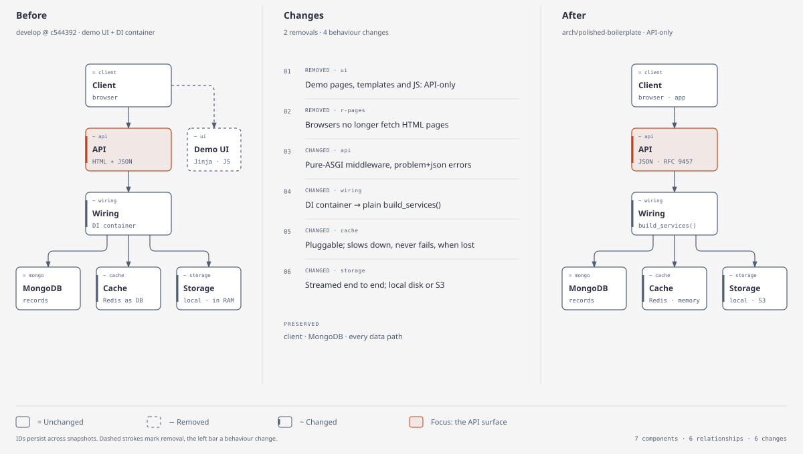

# What changed

The polished boilerplate replaces the original on `develop` (`c544392`). It keeps the same
purpose and the same stack (FastAPI, MongoDB, Redis) but is a different codebase: about
12,300 lines added and 35,300 removed across 273 files. This page says what moved and why,
and what someone upgrading an existing deployment has to do.

<picture>
  <source media="(prefers-color-scheme: dark)" srcset="../diagrams/before-after-dark.svg">
  
</picture>

## In one table

| Area | Before | After | Why |
| --- | --- | --- | --- |
| Shape | API + demo web UI (Jinja templates, ~5k lines of JS/CSS) | API only | The UI exposed unauthenticated writes and forced tokens into JavaScript ([ADR 0002](../adr/0002-api-only.md)). |
| Wiring | `dependency-injector` container, class store, global state | `build_services()`: plain constructors, one `Services` object per app | Visible lifetimes, isolated tests ([ADR 0004](../adr/0004-plain-wiring-and-pluggable-backends.md)). |
| Configuration | `config.d/*.json` (16 files) loaded dynamically | One typed `Settings` model; `config.toml` + local/secret TOML + `.env` + `FABP_*` variables | Typos and bad values fail at startup, naming file and key ([configure](../how-to/configure.md)). |
| Middleware | `BaseHTTPMiddleware` classes incl. circuit breaker, serialization, template context | Pure-ASGI stack: request id, headers, body limit, CSRF, CORS, errors, access log, timeout, rate limit, idempotency, session, RBAC | Streaming stays streaming; new protections ([pipeline](../ARCHITECTURE.md#the-request-pipeline)). |
| Errors | Ad-hoc JSON | RFC 9457 `application/problem+json` everywhere | One machine-readable error shape ([errors](../reference/api.md#errors)). |
| Tokens | JWT access/refresh, valid until expiry | Tokens carry a session id; logout, reset and refresh reuse revoke at once | Revocation that works ([ADR 0001](../adr/0001-session-bound-tokens.md)). |
| Access control | Roles, permissions and groups stored in MongoDB | Definitions in `config.toml`; assignments on the user; temporary grants in the DB | One source of truth per kind of data. |
| Cache | Redis modelled as a database | `CacheInterface` (Redis or in-memory, or your own) that degrades when lost | Outages slow requests down instead of failing them ([ADR 0005](../adr/0005-scale-out-files-and-cache-resilience.md)). |
| Databases | MongoDB, Redis, PostgreSQL and SQLite adapters | MongoDB, or your own class | Unused adapters removed; one interface kept for a second implementation. |
| Files | Whole files in memory, local disk only | Streamed end to end, local disk or S3, quotas, version limits | Memory no longer grows with file size. |
| Spreadsheets | Excel COM, LibreOffice subprocess or Python, by OS | One pure-Python processor; xlsx edited in place, charts and images kept | The LibreOffice path lost data ([ADR 0003](../adr/0003-pure-python-spreadsheets.md)). |
| Logging, metrics, tracing | Packages of custom handlers and decorators | Standard library logging via a queue; Prometheus, OpenTelemetry and Sentry SDKs used directly | Less code, same signals. |
| OAuth | Google and Apple | Google | Others are added in `models/oauth.py` (`OAuthProvider`) and `services/oauth/providers/`. |
| Setup | Manual | `make setup` / `make up` / `make run` | Clone to running in minutes ([getting started](../tutorials/getting-started.md)). |
| Tests | None | 197 tests, no services needed, run in CI | A safety net for every change below. |

## Added

- `app/settings.py` (every setting, typed and described) and the generated
  [configuration reference](../CONFIGURATION.md).
- Middleware: `body_limit`, `csrf`, `idempotency`, `access_log`; RBAC split from authentication.
- `app/cache/` (Redis, memory) and `app/services/file/storage/s3.py`.
- `xlsx_package.py` / `xlsx_patch.py` for in-place workbook edits.
- Versioned data migrations (`services/data/migrations.py`) and declared indexes (`schema.py`).
- User administration (`/api/v1/users`), self-service password change and profile edit.
- Health, liveness, readiness and startup probes.
- `Makefile`, CI workflow, pre-commit, Dockerfile health check, `docker-compose` with
  loopback-only ports and generated passwords.
- ADRs 0001–0005 and this documentation set.

## Removed

- Demo routes, templates and static assets (`app/api/routes/demo`, `app/templates`, `app/static`).
- `app/core/container.py`, `class_store.py`, `dynamic_config.py`, and five single-use service
  interfaces.
- `config.d/`, `project.toml`, `setup.cfg`, the old `docs/` set.
- PostgreSQL/SQLite adapters, Redis-as-database, LibreOffice/Excel spreadsheet back ends,
  the Apple provider, the retry service and the circuit-breaker middleware.

## Upgrading an existing deployment

1. **Configuration.** Move values from `config.d/*.json` into `config.local.toml` (or
   `FABP_<NAME>` variables). Run `python -m app.settings check`; it names anything unknown.
2. **Secrets.** Set `FABP_JWT_SECRET` (32+ characters) or let the first start generate
   `config.secrets.toml`. Every previously issued token stops working: tokens now need a session.
3. **Administrator.** There is no default admin. Set the `bootstrap_admin_*` settings once if
   the user collection is empty.
4. **Roles.** Copy role and group definitions into `config.toml`. Migration 1 drops the old
   role/permission/group indexes; the old collections can then be deleted.
5. **Files.** Migration 2 flags the newest version of every file (`is_latest`); it runs once on
   startup and is safe to run on several workers.
6. **Clients.** Auth cookies are HttpOnly now; browsers can no longer read tokens. Cookie-authenticated
   writes must come from an allowed origin (`cors_origins`). Errors arrive as problem+json.
