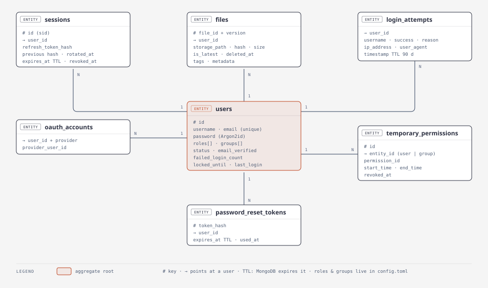
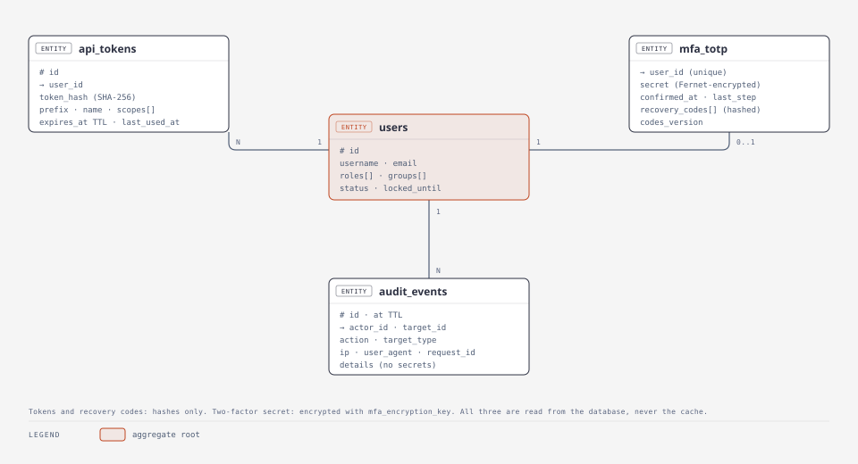

# Data model

MongoDB database `app_database` (default `fastapi_boilerplate`), or, with
`app_database_provider = "postgres"`, a PostgreSQL schema of that name holding one JSONB table per
collection. Collections are created on first write; their indexes are declared in `app/services/data/schema.py` and applied on every
start-up. Each collection is read and written only through its ops class in
`app/services/data/`.

<picture>
  <source media="(prefers-color-scheme: dark)" srcset="../diagrams/data-model-dark.svg">
  
</picture>

<picture>
  <source media="(prefers-color-scheme: dark)" srcset="../diagrams/security-data-dark.svg">
  
</picture>

Roles, groups and their permissions are **not** in the database: they are configuration
(`[rbac_roles.*]`, `[rbac_groups.*]` in `config.toml`). Only assignments (on the user) and
temporary grants are stored.

## Collections

### `users` (`UsersOps`)

| Field | Notes |
| --- | --- |
| `id` | UUID; unique index. |
| `username`, `email` | Unique indexes (`email` sparse: provider sign-ups may lack one). |
| `password` | Argon2id hash, re-hashed on sign-in when parameters are raised. Absent for provider-only accounts. |
| `roles`, `groups` | Assignments; role and group names must exist in configuration. |
| `status` | `active`, `inactive`, `suspended`, `pending`. Anything but `active` cannot sign in. |
| `email_verified` | Set by a completed password reset or a provider sign-in. |
| `failed_login_count`, `locked_until`, `last_login` | Lockout state, updated atomically. |
| `profile` | `first_name`, `last_name`, ... |

Cached under three keys (id, username, email); every write drops all three. Security decisions
(sign-in, refresh) read the database directly (`fresh=True`).

### `sessions` (`SessionsOps`)

One per sign-in. `id` is the `sid` inside both tokens. Stores `refresh_token_hash` (SHA-256,
never the token), the previous hash and `rotated_at` (for the reuse grace window),
`device_info`, `created_at`, `last_used_at`, `expires_at`, `revoked_at`. Indexes: unique `id`;
`(user_id, created_at desc)`; **TTL on `expires_at`**, so MongoDB deletes expired sessions.

### `login_attempts`

Append-only audit of every sign-in: `username`, `user_id`, `success`, `reason`
(`unknown_user`, `account_inactive`, `account_locked`, `invalid_password`), `ip_address`,
`user_agent`, `timestamp`. **TTL 90 days.**

### `audit_events` (`AuditService`)

Append-only security changes: `id`, `at`, `action`, `actor_id`, `target_type`, `target_id`,
`ip_address`, `user_agent`, `request_id`, `details` (flat identifiers and counts, values clipped
to 200 characters). Indexes: `id` (unique), `(actor_id, at desc)`,
`(target_type, target_id, at desc)`, `(action, at desc)`. **TTL on `at`:**
`audit_retention_days` (365 by default). Written by services after a change succeeds; a failed
write is logged and never fails the change.

### `api_tokens` (`ApiTokenManager`)

Personal access tokens: `id` (unique), `user_id`, `name`, `prefix` (first characters, for
recognising a token), `token_hash` (SHA-256, unique; the token itself is never stored),
`scopes`, `created_at`, `expires_at`, `last_used_at` (written at most once a minute). **TTL on
`expires_at`.** Read from the database on every request, so revocation is immediate.

### `jobs` (`JobService`)

Background jobs: `id` (unique), `name`, `payload`, `status` (`queued`, `running`, `done`,
`dead`), `attempts`, `run_at`, `lease_until`, `worker`, `last_error`, optional
`idempotency_key` (sparse unique), `created_at`, `updated_at`, `finished_at`. Indexes serve the
worker's queries: `(status, run_at)` and `(status, lease_until)`. **TTL on `finished_at`:**
`jobs_retention_days` (14); unfinished jobs never expire.

### `mfa_totp` (`MFAService`)

One record per user with an authenticator app: `user_id` (unique), `secret` (**encrypted** with
`mfa_encryption_key`), `confirmed_at` (None while setup is unfinished), `last_step` (the last
accepted 30-second step; a code at or before it is refused), `recovery_codes` (SHA-256 hashes),
`codes_version` (bumped on every change to the list, so concurrent uses cannot resurrect a
code), `created_at`. Always read from the database, never the cache.

### `files` (`FilesOps`)

One record per **version**: `file_id` + `version` (unique together), `user_id`, `filename`,
`content_type`, `size`, `hash` (SHA-256), `storage_path`, `storage_backend`, `tags`, `metadata`,
`thumbnail_paths`, `is_latest`, `created_at`, `updated_at`, `deleted_at` (soft delete).

`is_latest` marks the newest version so listings page in the database. Only `FilesOps` writes
file records, which keeps that flag true. Indexes: `(file_id, version desc)` unique;
`(user_id, hash)` for de-duplication; `(user_id, is_latest, deleted_at, created_at desc)` for the
listing; `(user_id, tags)`. Always read from the database, never the cache: ownership and
deletion decide access.

### `temporary_permissions` (`TemporaryPermissionsOps`)

`entity_type` (`user` or `group`), `entity_id`, `permission_id`, optional `start_time` and
`end_time`, `revoked_at`, `created_by`. Active means started, not ended, not revoked. Indexes on
`id` (unique), `entity_id`, `end_time`.

### `oauth_accounts` (`OAuthOps`)

Links a provider identity to a user: `user_id` + `provider` (unique together),
`provider_user_id`. Provider tokens are deliberately not stored.

### `password_reset_tokens`

`token_hash` (unique), `user_id`, `created_at`, `expires_at`, `used_at`. A new request expires
earlier unused tokens; confirming consumes the token atomically. **TTL on `expires_at`.**

### `schema_migrations`

Which migrations have run: `version`, `description`, `applied_at`.

## Migrations

`app/services/data/migrations.py` runs every migration not yet recorded, in order, at start-up.
Each must be idempotent: several workers may start together.

| Version | What |
| --- | --- |
| 1 | Drop indexes superseded by the current schema (including the old RBAC collections). |
| 2 | Flag the newest version of every file `is_latest` (backfill in batches of 500). |

Add one by appending `Migration(n, "what", fn)`. Never edit or reorder a released one.

## Rules that keep the data honest

- `DataService.set` is an **upsert**; `update` never creates. Use `update` for edits, so a
  stale id cannot leave a half-empty record behind.
- Writes **invalidate** cache entries rather than caching the written fragment.
- Queries without `limit` are capped at 10,000 results (with a warning); collections are paged.
- Datetimes are timezone-aware UTC everywhere, including values that pass through the cache.
